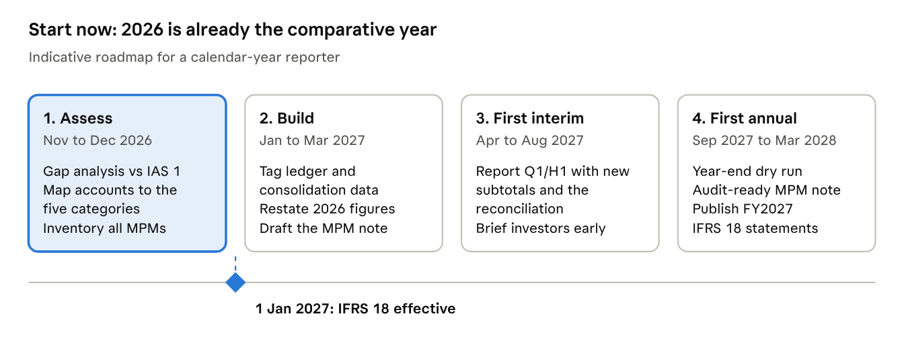

# IFRS 18 Transition: Executive Brief

Nov 27, 2026 · Rehan

## Why it matters now

IFRS 18 *Presentation and Disclosure in Financial Statements* replaces IAS 1 for annual periods beginning on or after 1 January 2027, with early application permitted. It is applied retrospectively, so a calendar-year company must restate its 2026 comparatives: the transition year is already under way. Recognition and measurement do not change, but how profit is structured, labelled and explained does, and that is what investors, lenders and boards see first.

## What changes

| Area | New requirement |
| --- | --- |
| Income statement structure | Every income and expense item goes into one of five categories: operating, investing, financing, income taxes, discontinued operations. Banks, insurers and investment entities follow specific rules for their main business activities. |
| Defined subtotals | Two new mandatory subtotals: **operating profit** and **profit before financing and income taxes**. |
| Management-defined performance measures (MPMs) | Non-GAAP subtotals used in public communications (e.g. adjusted EBIT) must be disclosed in one note, reconciled to the nearest IFRS subtotal, with tax and non-controlling interest effects per reconciling item. These figures fall within the audit. |
| Aggregation and disaggregation | New principles on grouping by shared characteristics; vague "other" labels are restricted. If expenses are presented by function, depreciation, amortisation, employee benefits, impairments and inventory write-downs must also be disclosed by nature. |
| Cash flow statement (IAS 7) | The indirect method starts from operating profit. For most companies, interest and dividends paid move to financing, and interest and dividends received move to investing. |

## Key impacts on companies

- **Reported KPIs move.** Operating profit will differ from today's EBIT for many groups, for example where share of associates' results or FX on financing sit today.
- **Data and systems.** The chart of accounts and consolidation tool need new category tags, often at transaction level (FX, fair value gains, interest).
- **Contracts and pay.** Loan covenants, bonus plans and analyst guidance built on current subtotals need review.
- **Governance over MPMs.** Investor-presentation measures now need audit-ready definitions, reconciliations and controls.
- **Communication.** Investors, lenders and the audit committee should hear about the changed numbers before the first interim report does it for you.

## Transition requirements

- **Full retrospective application** under IAS 8, with comparatives restated into the new structure.
- **Reconciliation note** in the first IFRS 18 annual statements: for each income statement line, the restated comparative amount against the amount previously reported under IAS 1.
- **Interim reports** in the first year (IAS 34) must already show the new headings and subtotals, plus the same line-by-line reconciliation for comparative periods.
- **One-off election** for entities with specified main business activities to change how they measure investments in associates and joint ventures (fair value or equity method).

## Practical roadmap

Start now: 2026 is already the comparative year (indicative roadmap for a calendar-year reporter). Gate: **1 Jan 2027, IFRS 18 effective**.

| Phase | Timing | Key actions |
| --- | --- | --- |
| 1. Assess | Nov to Dec 2026 | Gap analysis vs IAS 1; map accounts to the five categories; inventory all MPMs |
| 2. Build | Jan to Mar 2027 | Tag ledger and consolidation data; restate 2026 figures; draft the MPM note |
| 3. First interim | Apr to Aug 2027 | Report Q1/H1 with new subtotals and the reconciliation; brief investors early |
| 4. First annual | Sep 2027 to Mar 2028 | Year-end dry run; audit-ready MPM note; publish FY2027 IFRS 18 statements |

The critical path is data: if 2026 transactions are not tagged to the new categories, comparatives must be rebuilt by hand. Non-calendar year-ends shift each phase by the same offset. The transition paper, manual and deck will expand each phase into detailed steps and templates.
